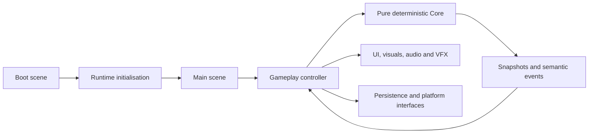

# Jelly Riot design and architecture

The complete product design is in `Assets/Jelly_Riot_Codex_Master_Plan.md`. This document records implementation-facing decisions.

## Runtime shape

- `Boot` is deliberately minimal: it establishes the 60 FPS target and loads `Main`.
- `Main` is currently a presentation shell. Screens and gameplay controllers belong to later work orders.
- Core owns board coordinates, placement, random state and snapshots. It has no Unity dependency.
- Unity ScriptableObjects expose tuning data, then adapt it to immutable Core configuration.
- Ads, analytics, audio, haptics, sharing and persistence are boundary interfaces. Implementations arrive only in their scheduled work orders.

## Determinism contract

Given the same seed, balance values and actions, Core must produce the same board, generated colour stream, turn count and random state. Invalid actions do not modify any of those values. Animation, elapsed time and frame rate are never inputs.

## Board contract

- 7 columns by 9 rows.
- `(0,0)` is top-left; row 8 is the bottom.
- Empty is an explicit `JellyColour.Empty` value.
- Initial boards contain 20 occupied cells (31.7%), use three active colours, remain in the bottom four rows, contain no connected group of four, and guarantee a one-drop opening match opportunity.

## Resolution contract

- Match connectivity is orthogonal only and is found with an iterative flood fill.
- Every qualifying connected component is recorded before any cell in that wave is removed.
- Gravity is vertical and stable: occupied cells compact toward row 8 without changing their relative order.
- Resolution repeats synchronously until stable. Each successful wave removes at least four cells, so a 63-cell board must terminate in at most 15 waves.
- `BoardResolutionResult` exposes ordered, read-only waves. Each wave records its zero-based index, cleared cells with colours, and every fall with source, destination and colour.
- Core owns the entire calculation and does not use Unity objects, transforms, time, coroutines or presentation state.

`GameTest.unity` is a development-only playable inspection scene and is intentionally excluded from build settings. It displays immediate Core state so current behaviour can be exercised before the production presentation and session layers are scheduled.

## UI policy

Future canvases use `Scale With Screen Size`, reference resolution 1080x1920, portrait orientation and safe-area containers. Layouts must remain usable at 16:9 and 19.5:9 without placing essential controls in gesture or cut-out areas.

